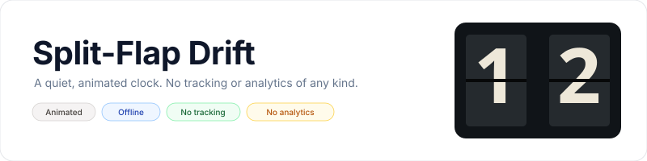
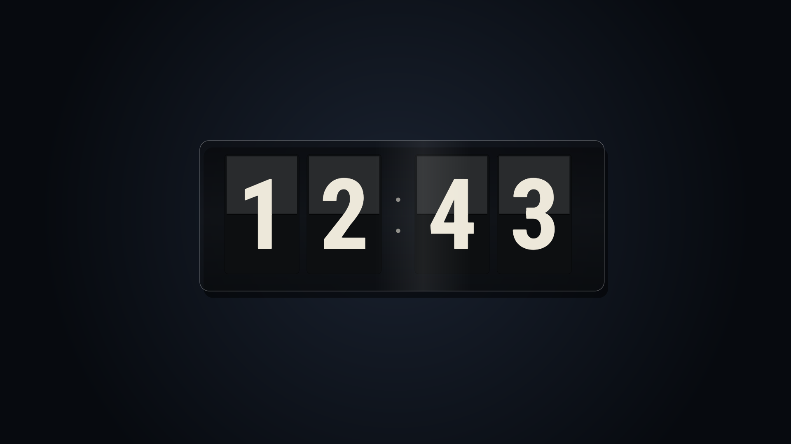

<p align="center">
    <picture>
        <source media="(prefers-color-scheme: dark)" srcset="art/banner-dark.svg">
        <source media="(prefers-color-scheme: light)" srcset="art/banner-light.svg">
        
    </picture>
</p>

<p align="center">A slowly moving split-flap clock for Fire TV, Android TV, and Google TV.</p>

<p align="center">
  <a href="https://github.com/jeremykenedy/split-flap-drift/releases"></a>
  <a href="https://github.com/jeremykenedy/split-flap-drift/releases"></a>
  <a href="LICENSE"></a>
  <a href="https://github.com/jeremykenedy/split-flap-drift/stargazers"></a>
  <a href="https://github.com/jeremykenedy"></a>
  <a href="https://github.com/sponsors/jeremykenedy"></a>
</p>

## Table of Contents

- [Overview](#overview)
- [Screenshots](#screenshots)
- [Features and settings](#features-and-settings)
- [Requirements](#requirements)
- [Installation and activation](#installation-and-activation)
- [Fire TV Toolkit](#fire-tv-toolkit)
- [Privacy](#privacy)
- [Device support](#device-support)
- [Build and tests](#build-and-tests)
- [Documentation](#documentation)
- [Credits](#credits)
- [License](#license)

## Overview

Split-Flap Drift is an original Android DreamService that shows a locally rendered clock on individually hinged-looking cards. A slow screen drift and moving reflection keep the display animated between time changes. It includes no third-party artwork, fonts, or runtime dependencies.

Show some love by starring this repository on GitHub.

## Screenshots

Captured from the running app on a Google Android TV emulator at 1920 x 1080. The preview ran for more than 45 seconds before capture.

<p align="center">
  <a href="docs/screenshots/split-flap-android-tv-api31-1920x1080.png"></a>
</p>

## Features and settings

- Animated split-flap cards, subtle drifting placement, and a slow moving glass reflection.
- 12-hour or 24-hour time, with optional seconds and date.
- Midnight, ivory, or ocean finishes.
- Auto, day, or night lighting and a separate brightness level.
- Flip pace and clock scale controls.
- Each supported setting can be set to Random; random choices resolve when the screensaver starts.
- Remote-friendly settings screen and a versioned settings provider for host apps.

The renderer uses Android Canvas at the display-provided size and schedules frames while visible. It does not force a 4K surface. The clock display is not a licensed replica of a particular commercial clock app or device.

## Requirements

- Android 6.0 (API 23) or newer.
- A TV device that supports Android DreamService screensavers.
- For building: Android SDK platform 36, build-tools 36.0.0, Java, `adb`, and standard shell tools.

## Installation and activation

Download `split-flap-drift.apk` and its `.sha256` file from the [latest release](https://github.com/jeremykenedy/split-flap-drift/releases/latest). Connect ADB to the TV and run the guided installer:

```bash
adb connect TV_IP:5555
python3 install.py --device TV_IP:5555 --apk ~/Downloads/split-flap-drift.apk
```

The installer verifies the downloaded build checksum, saves the TV's prior screensaver selection and enabled state, explains changes, and asks before applying them. To restore the previous selection:

```bash
python3 install.py --device TV_IP:5555 --restore
```

To restore and uninstall the app:

```bash
python3 install.py --device TV_IP:5555 --uninstall
```

Alternatively, install the APK with the TV's package installer. Open Split-Flap Drift from the app list to preview it or change settings. To select it as the system screensaver, open the TV's display or screensaver settings and choose Split-Flap Drift. Menu names vary by device. The installer does not alter sleep timeouts or claim to prevent vendor software from changing system settings.

## Fire TV Toolkit

[Fire TV Toolkit](https://github.com/jeremykenedy/fire-tv-toolkit) provides a guided terminal installer for screensavers and helps manage selection, device settings, sleep timers, and supported safeguards. Install the Toolkit from a fresh checkout:

```bash
git clone https://github.com/jeremykenedy/fire-tv-toolkit.git
cd fire-tv-toolkit
node setup.js
```

After Split-Flap Drift is present in the Toolkit catalog, these commands install it and select it:

```bash
firetv-screensavers --install=split-flap-drift --yes
screensaver --set=split-flap-drift
```

Remove the screensaver with `firetv-screensavers --uninstall=split-flap-drift --force --yes`. Use `firetv-revert` to review and restore the Toolkit-managed settings. The separate Fire TV UI app can select installed DreamServices and show a bundled preview; it does not install arbitrary GitHub APKs.

## Privacy

The app requests no Internet permission and makes no network requests. It has no ads, analytics, telemetry, crash reporting, tracking, or remote update checks. Time and date are read locally from the device. See [Privacy](docs/PRIVACY.md).

## Device support

| Device | Status | Notes |
|---|---|---|
| Android TV emulator, Google Android TV API 31, 1920 x 1080 | Tested | Signed app installed and clock preview rendered. The captured scene ran for more than 45 seconds. |
| Fire TV hardware | Untested | Looking for a Fire TV owner to test selection, idle startup, remote settings and exit behavior, then report model, Fire OS/API, resolution and results in [Issues](https://github.com/jeremykenedy/split-flap-drift/issues). |
| Android TV hardware | Untested | Looking for an Android TV owner to test device behavior and report model, OS/API, resolution and results in [Issues](https://github.com/jeremykenedy/split-flap-drift/issues). |
| Google TV hardware | Untested | Looking for a Google TV owner to test device behavior and report model, OS/API, resolution and results in [Issues](https://github.com/jeremykenedy/split-flap-drift/issues). |
| Native 4K output and sustained thermal behavior | Untested | Requires a physical 4K TV. The app renders at the size Android supplies and makes no native 4K performance claim. |

## Build and tests

```bash
./test.sh
./build.sh --unsigned
./build.sh
```

The signed build creates a unique local keystore under `~/.android/`. Keep that keystore and its password backed up securely; they are excluded from Git and required for compatible updates. The unsigned build is for review and cannot be installed as a signed release.

## Documentation

- [Architecture](docs/ARCHITECTURE.md)
- [Artwork and screenshot provenance](docs/ARTWORK.md)
- [Building](docs/BUILDING.md)
- [Configuration](docs/CONFIGURATION.md)
- [Installation](docs/INSTALLATION.md)
- [Privacy](docs/PRIVACY.md)
- [Release process](docs/RELEASING.md)
- [Settings provider](docs/SETTINGS_PROVIDER.md)
- [Troubleshooting](docs/TROUBLESHOOTING.md)
- [Verification and device matrix](docs/VERIFICATION.md)

## Credits

The clock artwork and rendering code are original to this repository. No third-party media or fonts are bundled.

## License

Split-Flap Drift is licensed under the [Apache License, Version 2.0](LICENSE). See [NOTICE](NOTICE) for project notices.
